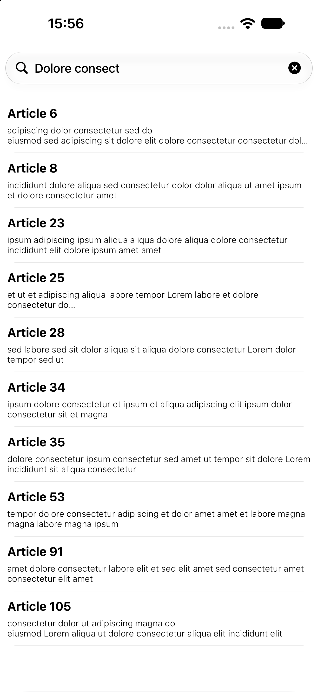

# ArticleExplorer

Swift ve UIKit kullanılarak geliştirilen, makalelerin listelendiği ve arama yapılabildiği bir iOS uygulaması.

Bu proje, UITableView ile özel hücre tasarımını, UISearchBar kullanarak liste filtrelemeyi ve pagination (sayfalı veri yükleme) mantığını öğrenmek amacıyla hazırlanmıştır.

Uygulamada toplam 105 örnek makale bulunur. Makaleler başlangıçta 20'şer öğelik gruplar halinde yüklenir. Kullanıcı listeyi aşağı kaydırdıkça sonraki makaleler yüklenir. Arama yapıldığında ise başlık ve kısa açıklama alanlarında eşleşen makaleler filtrelenir.

## Ekran Görüntüsü

<p align="center">
  
</p>

## Özellikler

- Makaleleri UITableView içerisinde listeleme
- Başlık ve kısa açıklama gösterimi
- XIB ile özel UITableViewCell tasarımı
- UISearchBar ile anlık arama
- Büyük/küçük harf duyarsız arama
- Başlık ve kısa açıklamaya göre filtreleme
- Pagination ile makaleleri 20'şer öğelik gruplar halinde yükleme
- Liste aşağı kaydırıldığında otomatik olarak yeni içerik yükleme

---

## Article Modeli

Makalelerin verilerini temsil etmek için `Article` adında bir model sınıfı oluşturulmuştur.

**Article.swift**

```swift
class Article {
    var title: String
    var shortDescription: String
    var description: String

    init(title: String, shortDescription: String, description: String) {
        self.title = title
        self.shortDescription = shortDescription
        self.description = description
    }
}
```

Her makale üç bilgiden oluşur:

| Property | Açıklama |
|---|---|
| `title` | Makalenin başlığı |
| `shortDescription` | Liste ekranında gösterilen kısa açıklama |
| `description` | Makalenin uzun açıklaması |

Bu projede liste ekranında yalnızca başlık ve kısa açıklama gösterilmektedir. `description` alanı modelde bulunmasına rağmen mevcut arayüzde kullanılmamaktadır.

---

## UITableView ve Özel Hücre

Makaleler `UITableView` kullanılarak satırlar halinde görüntülenir.

Standart UITableViewCell yerine `ArticleTableViewCell` adında özel bir hücre sınıfı oluşturulmuştur.

### ArticleTableViewCell.swift

```swift
class ArticleTableViewCell: UITableViewCell {

    @IBOutlet weak var titleLabel: UILabel!
    @IBOutlet weak var shortDescriptionLabel: UILabel!

}
```

Bu hücre iki UILabel içerir:

- `titleLabel`: Makale başlığını gösterir.
- `shortDescriptionLabel`: Makalenin kısa açıklamasını gösterir.

Hücrenin arayüzü `ArticleTableViewCell.xib` dosyasında tasarlanmıştır. XIB içerisindeki UILabel bileşenleri, Swift sınıfındaki IBOutlet özelliklerine bağlanmıştır.

### XIB kullanımı

XIB, arayüz bileşenlerini Storyboard'dan bağımsız olarak tasarlamayı sağlar.

Bu projede özel hücreyi ana Storyboard içerisinde tasarlamak yerine ayrı bir XIB dosyasında tutarak hücre tasarımını ViewController kodundan ayırdık.

Hücre, `cellForRowAt` içerisinde `Bundle.main.loadNibNamed` kullanılarak yüklenir.

```swift
let cell = Bundle.main.loadNibNamed(
    "ArticleTableViewCell",
    owner: self,
    options: nil
)?.first as! ArticleTableViewCell
```

Yüklenen hücre, ilgili Article nesnesinin bilgileriyle yapılandırılır.

### UITableViewDataSource

UITableView'in veri kaynağı `ViewController` sınıfıdır.

**numberOfRowsInSection**

```swift
func tableView(
    _ tableView: UITableView,
    numberOfRowsInSection section: Int
) -> Int {
    return loadedArticles.count
}
```

Tabloda gösterilecek satır sayısı `loadedArticles` dizisinin eleman sayısına göre belirlenir.

Burada önemli bir ayrıntı var: Tüm makaleler `allArticles` içerisinde bulunmasına rağmen UITableView doğrudan bu diziyi kullanmaz. Yalnızca o anda görüntülenmesi gereken verileri içeren `loadedArticles` dizisini kullanır.

**cellForRowAt**

```swift
func tableView(
    _ tableView: UITableView,
    cellForRowAt indexPath: IndexPath
) -> UITableViewCell {

    let cell = Bundle.main.loadNibNamed(
        "ArticleTableViewCell",
        owner: self,
        options: nil
    )?.first as! ArticleTableViewCell

    cell.titleLabel.text = loadedArticles[indexPath.row].title
    cell.shortDescriptionLabel.text = loadedArticles[indexPath.row].shortDescription

    return cell
}
```

Bu metot her satır için XIB üzerinden özel hücre oluşturur ve ilgili makalenin başlık ve kısa açıklamasını hücreye aktarır.

**Not:** Bu örnekte hücreler her çağrıda XIB üzerinden yeniden yüklenmektedir. Daha büyük listelerde XIB'yi `register(_:forCellReuseIdentifier:)` ile kaydedip `dequeueReusableCell(withIdentifier:for:)` kullanarak hücre yeniden kullanımını sağlamak daha verimli olacaktır.

---

## Pagination (Sayfalı Veri Yükleme)

Pagination, büyük veri kümelerinin tamamını tek seferde yüklemek yerine belirli büyüklükte gruplar halinde yükleme yaklaşımıdır.

Örneğin 1000 makaleyi aynı anda listeye eklemek yerine ilk 20 makaleyi gösterebilir, kullanıcı listeyi aşağı kaydırdıkça sonraki 20 makaleyi yükleyebiliriz.

Bu yaklaşım özellikle uzun listelerde gereksiz hücre oluşturma ve veri işleme maliyetini azaltmaya yardımcı olur.

Bu projede 105 örnek makale bulunur ve her sayfada 20 makale gösterilir.

### Veri dizileri

Projede üç ayrı dizi kullanılmıştır:

```swift
var allArticles: [Article] = []
var loadedArticles: [Article] = []
var filteredArticles: [Article] = []

var page = 0
```

| Değişken | Görevi |
|---|---|
| `allArticles` | Uygulamadaki tüm makaleleri saklar. |
| `filteredArticles` | Arama sonucunda eşleşen makaleleri saklar. |
| `loadedArticles` | UITableView üzerinde o anda gösterilecek makaleleri saklar. |
| `page` | Mevcut sayfanın indeksini takip eder. |

Bu dizilerin birbirinden ayrılması önemlidir.

Örneğin arama yapıldığında tüm verileri kaybetmemek için orijinal liste `allArticles` içerisinde korunur. Filtrelenmiş sonuçlar `filteredArticles` içerisine aktarılır. UITableView ise yalnızca `loadedArticles` dizisini görüntüler.

### İlk 20 makalenin yüklenmesi

`viewDidLoad()` içerisinde 105 örnek makale oluşturulur.

```swift
for i in 0..<105 {
    article = Article(
        title: "Article \(i + 1)",
        shortDescription: generateLoremIpsum(wordCount: 15),
        description: generateLoremIpsum(wordCount: 100)
    )

    allArticles.append(article)

    if i < 20 {
        loadedArticles.append(article)
    }
}

filteredArticles.append(contentsOf: allArticles)
articlesTableView.reloadData()
```

Burada bütün makaleler `allArticles` dizisine eklenirken yalnızca ilk 20 makale `loadedArticles` dizisine aktarılır.

Böylece UITableView başlangıçta yalnızca 20 makale görüntüler.

`filteredArticles` ise başlangıçta tüm makalelerin kopyası olarak hazırlanır. Böylece henüz arama yapılmamışken pagination işlemi tüm makaleler üzerinden çalışabilir.

### scrollViewDidScroll

Yeni makalelerin ne zaman yükleneceğini belirlemek için `scrollViewDidScroll` metodu kullanılır.

```swift
func scrollViewDidScroll(_ scrollView: UIScrollView) {
    if (scrollView.contentOffset.y + scrollView.frame.size.height)
        > (scrollView.contentSize.height * 0.9) {
        loadMoreArticles()
    }
}
```

Bu metot, kullanıcı kaydırma yaptığında çağrılır.

Burada üç önemli değer kullanılır:

- `contentOffset.y`: Kaydırma alanının dikey konumunu belirtir.
- `frame.size.height`: Görülebilen scroll view alanının yüksekliğidir.
- `contentSize.height`: Kaydırılabilir içeriğin toplam yüksekliğidir.

Kod, kullanıcının görünür alanının alt sınırının toplam içerik yüksekliğinin %90'ını geçip geçmediğini kontrol eder.

Başka bir ifadeyle kullanıcı listenin sonuna ulaşmadan, yaklaşık son %10'luk bölüme geldiğinde yeni içerik yükleme işlemi başlatılır.

**Neden UIScrollView metodu kullanılıyor?**

`UITableView`, `UIScrollView` sınıfından türemiştir. Bu nedenle kaydırma davranışıyla ilgili `scrollViewDidScroll` gibi delegate metotlarını kullanabiliriz.

Böylece ayrıca bir scroll view oluşturmadan UITableView'in kaydırma hareketini takip edebiliriz.

### loadMoreArticles

Yeni makaleleri yükleyen metot:

```swift
func loadMoreArticles() {
    if ((page + 1) * 20) < filteredArticles.count {
        for i in (page + 1) * 20 ..< (page + 2) * 20 {
            if i < filteredArticles.count {
                loadedArticles.append(filteredArticles[i])
            }
        }

        page += 1
        articlesTableView.reloadData()
    }
}
```

Buradaki temel mantık, daha önce yüklenmiş makalelerin devamındaki 20 öğeyi `loadedArticles` dizisine eklemektir.

Örneğin:

| Sayfa | Yüklenen makale indeksleri | Toplam yüklü |
|---|---|---:|
| 0 | 0–19 | 20 |
| 1 | 20–39 | 40 |
| 2 | 40–59 | 60 |
| 3 | 60–79 | 80 |
| 4 | 80–99 | 100 |
| 5 | 100–104 | 105 |

`page` değişkeni mevcut sayfanın indeksini takip eder. Her yeni grup yüklendiğinde bir artırılır.

**Son sayfanın kontrolü**

105 sayının 20'ye tam bölünmemesi nedeniyle son sayfada yalnızca 5 makale bulunur.

Bu nedenle döngü içerisinde:

```swift
if i < filteredArticles.count
```

kontrolü yapılır. Böylece dizi sınırlarının dışına çıkılması engellenir.

Tüm makaleler yüklendiğinde dış koşul artık sağlanmayacağı için yeni yükleme yapılmaz.

---

## UISearchBar ile Arama ve Filtreleme

Uygulamada makaleler arasında arama yapmak için `UISearchBar` kullanılmıştır.

Storyboard üzerinde UISearchBar oluşturulmuş ve delegate bağlantısı ViewController'a yapılmıştır.

ViewController, `UISearchBarDelegate` protokolünü uygular:

```swift
class ViewController: UIViewController,
                      UITableViewDelegate,
                      UITableViewDataSource,
                      UISearchBarDelegate {
}
```

### searchBar(_:textDidChange:)

Kullanıcı arama alanına her yeni karakter girdiğinde `textDidChange` delegate metodu çağrılır.

```swift
func searchBar(_ searchBar: UISearchBar, textDidChange searchText: String) {
    page = 0

    filteredArticles = searchText.isEmpty ? allArticles : allArticles.filter({
        (article: Article) -> Bool in

        return article.title.range(
            of: searchText,
            options: .caseInsensitive
        ) != nil ||

        article.shortDescription.range(
            of: searchText,
            options: .caseInsensitive
        ) != nil
    })

    loadedArticles.removeAll()

    for i in 0..<filteredArticles.count {
        if i < 20 {
            loadedArticles.append(filteredArticles[i])
        }
    }

    articlesTableView.reloadData()
}
```

Arama işlemi şu şekilde çalışır:

**1. Sayfa indeksini sıfırlama**

```swift
page = 0
```

Yeni bir arama yapıldığında pagination süreci baştan başlamalıdır.

Örneğin kullanıcı daha önce üçüncü sayfaya kadar ilerlemiş olabilir. Yeni bir arama sonucunda mevcut sayfa indeksini korumak, yanlış aralıktaki verilerin yüklenmesine neden olabilir.

**2. Makaleleri filtreleme**

```swift
filteredArticles = searchText.isEmpty
    ? allArticles
    : allArticles.filter({ article in
        article.title.range(
            of: searchText,
            options: .caseInsensitive
        ) != nil ||
        article.shortDescription.range(
            of: searchText,
            options: .caseInsensitive
        ) != nil
    })
```

Arama alanı boşsa tüm makaleler tekrar sonuç listesine aktarılır.

Arama alanı doluysa `allArticles` üzerinde filtreleme yapılır.

Arama iki alanda gerçekleştirilir:

- Makale başlığı (`title`)
- Makale kısa açıklaması (`shortDescription`)

`caseInsensitive` seçeneği, büyük ve küçük harf farklılıklarının arama sonucunu etkilememesini sağlar.

Örneğin `article`, `Article` ve `ARTICLE` aramalarında büyük/küçük harf duyarlılığı olmadan eşleşme yapılır.

**3. Önceki yüklenmiş verileri temizleme**

```swift
loadedArticles.removeAll()
```

Önceki arama sonucuna ait yüklenmiş makaleler temizlenir.

Bu adım önemlidir. Aksi durumda yeni arama sonuçlarıyla eski liste verileri birbirine karışabilir.

**4. İlk 20 filtrelenmiş sonucu yükleme**

Filtreleme tamamlandıktan sonra yalnızca ilk 20 sonuç `loadedArticles` dizisine aktarılır.

Böylece arama sonuçları da pagination mantığıyla görüntülenmeye devam eder.

**5. Tabloyu güncelleme**

```swift
articlesTableView.reloadData()
```

UITableView, yeni `loadedArticles` verisini okuyarak görünümünü yeniler.

---

## Veri Akışı

Uygulamanın veri akışı iki temel senaryo üzerinden düşünülebilir.

**İlk açılışta:**

```text
105 Articles
     |
     v
 allArticles
     |
     v
filteredArticles
     |
     v
 First 20 Articles
     |
     v
loadedArticles
     |
     v
  UITableView
```

**Arama yapıldığında:**

```text
Search Text
     |
     v
 allArticles
     |
     v
   Filter
     |
     v
filteredArticles
     |
     v
 First 20 Results
     |
     v
loadedArticles
     |
     v
  UITableView
```

Kullanıcı aşağı kaydırdığında `filteredArticles` içerisindeki sonraki 20 öğe `loadedArticles` dizisine eklenir.

Bu yapı sayesinde arama ve pagination aynı veri akışı içerisinde birlikte çalışır.

---

## Proje Yapısı

```text
ArticleExplorer/
├── ArticleExplorer.xcodeproj/
└── ArticleExplorer/
    ├── AppDelegate.swift
    ├── SceneDelegate.swift
    ├── ViewController.swift
    ├── Article.swift
    ├── ArticleTableViewCell.swift
    ├── ArticleTableViewCell.xib
    └── Base.lproj/
        └── Main.storyboard
```

## Kullanılan Teknolojiler

- **Swift** – Uygulamanın programlama dili.
- **UIKit** – Kullanıcı arayüzü.
- **UITableView** – Makale listesinin görüntülenmesi.
- **UITableViewDataSource** – Tablo verilerinin sağlanması.
- **UITableViewDelegate** – Tablo davranışlarının yönetilmesi.
- **UIScrollView** – Kaydırma hareketinin takip edilmesi.
- **UISearchBar** – Makale araması.
- **UISearchBarDelegate** – Arama alanındaki değişikliklerin yakalanması.
- **XIB / Interface Builder** – Özel tablo hücresinin tasarlanması.
- **IBOutlet** – Arayüz bileşenlerinin Swift sınıfına bağlanması.

## Öğrenilen Konular

- UITableView ve özel hücre kullanımı
- XIB üzerinden hücre yükleme
- UITableViewDataSource ve UITableViewDelegate
- UISearchBar ve UISearchBarDelegate
- Anlık arama ve filtreleme
- Büyük/küçük harf duyarsız arama
- Pagination ve sayfalı veri yükleme
- `scrollViewDidScroll` ile kaydırma takibi
- `contentOffset`, `contentSize` ve `frame` ilişkisi
- Arama ve pagination işlemlerinin birlikte yönetilmesi

## Notlar

Bu proje, pagination ve arama mantığını örnek veri üzerinde göstermek amacıyla hazırlanmıştır.

Mevcut uygulamada 105 makale `viewDidLoad()` içerisinde oluşturulmaktadır. Dolayısıyla burada gerçek bir API isteği veya sunucudan sayfalı veri çekme işlemi bulunmaz. Pagination, önceden bellekte bulunan makalelerin gruplar halinde UITableView'e aktarılmasıyla simüle edilmektedir.

Ayrıca hücreler XIB üzerinden her çağrıda yeniden yüklenmektedir. Büyük veri listelerinde hücre yeniden kullanımını sağlayan `dequeueReusableCell` yaklaşımı tercih edilmelidir.

Gerçek bir API entegrasyonunda ise sayfa numarası veya `offset/limit` gibi parametrelerle yalnızca ihtiyaç duyulan verilerin sunucudan istenmesi daha uygun olacaktır.