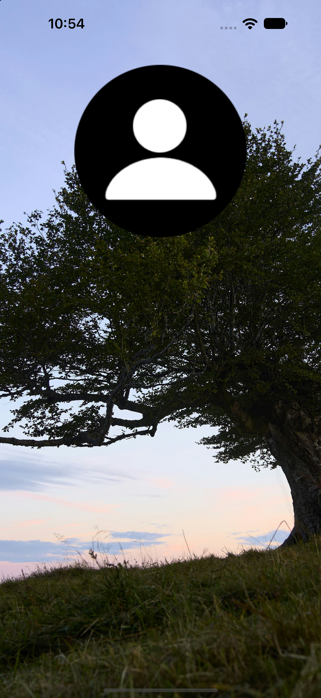

# Assets Tutorial

Bu uygulama, iOS projelerinde görsel ve renk kaynaklarının **Asset Catalog** kullanılarak nasıl yönetildiğini göstermek amacıyla hazırlanmıştır.

## Konu: Asset Catalog

iOS uygulamalarında kullanılan görseller, uygulama ikonları ve renkler Xcode'daki Asset Catalog (`Assets.xcassets`) içerisinde düzenlenebilir. Asset Catalog, bu kaynakları tek bir yerde toplar ve uygulama arayüzünde isimleri üzerinden kullanılmasını sağlar.

### Image Set

Görseller, Asset Catalog içerisinde birer **Image Set** olarak eklenir. Her Image Set, görsel dosyalarını ve bu dosyaların hangi cihaz ölçeği için kullanılacağını belirten `Contents.json` dosyasını içerir.

Xcode, görsellerin farklı çözünürlüklerini `1x`, `2x` ve `3x` ölçekleriyle tanımlamaya izin verir. Böylece uygulama, çalıştığı cihazın ekran yoğunluğuna uygun görseli seçebilir.

### Görsel Ölçekleri ve Performans

Asset Catalog içerisinde görseller `1x`, `2x` ve `3x` ölçekleriyle tanımlanabilir. Bu ölçekler, görselin farklı ekran yoğunluklarında uygun boyutta görüntülenmesini sağlar.

Örneğin, 100 × 100 point boyutunda bir `UIImageView` için:

| Ölçek | Gerekli piksel boyutu |
| --- | --- |
| 1x | 100 × 100 px |
| 2x | 200 × 200 px |
| 3x | 300 × 300 px |

iOS, cihazın ekran ölçeğine uygun görsel kaynağını seçer.

**Tek çözünürlük kullanılması:**
- Yalnızca tek bir görsel dosyası uygulama paketine eklenir.
- Uygulamanın indirme ve depolama boyutu daha küçük olabilir.
- Görsel, cihazın ekran yoğunluğuna uygun değilse bulanık veya pikselli görünebilir.
- Tek bir yüksek çözünürlüklü görsel kullanılması ise gereğinden fazla bellek tüketimine neden olabilir.

**1x, 2x ve 3x ölçeklerinin kullanılması:**
- Farklı ekran yoğunlukları için uygun çözünürlükte görseller sunulur.
- Görsel kalitesi farklı cihazlarda daha tutarlı olur.
- Birden fazla görsel dosyası uygulama paketinin boyutunu artırabilir.
- iOS, uygun ölçekli kaynağı seçerek gereksiz büyük görsel kullanımını önleyebilir.

**Performans açısından:** Birden fazla ölçek tanımlamak tek başına uygulamayı yavaşlatmaz. Ancak uygulama paketinin boyutu ve görsellerin bellekte kapladığı alan, görsellerin çözünürlüğüne ve kullanım şekline bağlıdır.

Bu nedenle görsellerin hedeflenen görüntüleme boyutuna uygun hazırlanması önemlidir.

### Görsellerin Arayüzde Kullanılması

Asset Catalog'a eklenen bir görsel, Interface Builder üzerinden bir `UIImageView` bileşeninin **Image** alanından seçilebilir. Kod tarafında ise asset adı kullanılarak `UIImage(named:)` ile yüklenebilir.

```swift
let imageView = UIImageView(image: UIImage(named: "profile"))
```

Burada dosya uzantısı değil, Image Set'in adı kullanılır.

### Color Set

Asset Catalog yalnızca görseller için değil, uygulama renklerini tanımlamak için de kullanılabilir. **Color Set** aracılığıyla renkler merkezi olarak tanımlanabilir ve arayüzün farklı bölümlerinde yeniden kullanılabilir. Ayrıca açık ve koyu görünüm gibi farklı appearance seçenekleri için renk varyasyonları belirlenebilir.

## Uygulamada Kullanılan Asset'ler

| Asset | Tür | Kullanım |
| --- | --- | --- |
| `background_tree` | Image Set | Ekran arka planı |
| `profile` | Image Set | Profil görseli |
| `background` | Image Set | Ek görsel kaynağı |
| `AccentColor` | Color Set | Uygulamanın vurgu rengi |

Arayüzde `background_tree` görseli tam ekran arka plan olarak, `profile` görseli ise bunun üzerinde konumlandırılmış bir görsel olarak kullanılmıştır.

## Ekran Görüntüsü

<p align="center">
  
</p>

## Kullanılan Teknolojiler

- Swift
- UIKit
- Xcode
- Interface Builder (Storyboard)
- Asset Catalog

## Öğrenilenler

- Xcode Asset Catalog yapısı
- Image Set ve Color Set oluşturma
- Görsellerin farklı ekran ölçekleri için tanımlanması
- Asset'lerin Storyboard üzerinden UIImageView bileşenlerinde kullanılması
- Asset isimleri üzerinden görsellere erişme