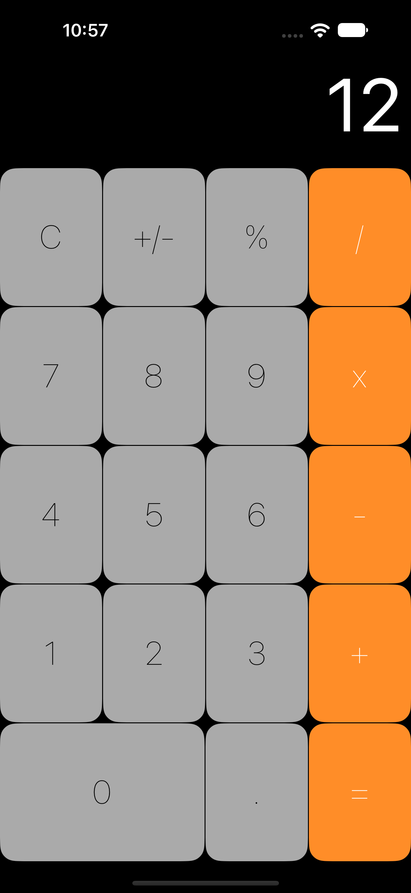

# Calculator UI

Bu uygulama, iOS arayüz geliştirme sürecinde Auto Layout ve Constraints kullanımını pekiştirmek amacıyla hazırlanmış bir hesap makinesi arayüzü çalışmasıdır.

Arayüz, UIKit ve Interface Builder kullanılarak Storyboard üzerinde oluşturulmuştur.

## Konu: Auto Layout ve Constraints

iOS uygulamalarında farklı ekran boyutlarına ve cihaz özelliklerine uyum sağlayan arayüzler oluşturmak için Auto Layout kullanılır.

Auto Layout, arayüz bileşenlerinin konumlarını ve boyutlarını sabit koordinatlar yerine birbirleriyle veya kapsayıcı görünümleriyle tanımlanan ilişkiler üzerinden belirler.

### Constraints Nedir?

Constraints, arayüz bileşenlerinin konumunu ve boyutunu belirleyen kurallardır.

Bir görünümün başka bir görünüme göre nerede konumlanacağını, genişliğini, yüksekliğini veya hizalamasını tanımlamak için kullanılır.

Başlıca constraint türleri:

| Constraint | Açıklama |
| --- | --- |
| Leading / Trailing | Görünümün yatay başlangıç ve bitiş konumlarını belirler. |
| Top / Bottom | Görünümün dikey başlangıç ve bitiş konumlarını belirler. |
| Width / Height | Görünümün genişliğini ve yüksekliğini belirler. |
| Center X / Center Y | Görünümü yatay veya dikey eksende ortalar. |
| Aspect Ratio | Genişlik ve yükseklik arasındaki oranı belirler. |

### Constraint İlişkileri

Constraints yalnızca sabit mesafeler tanımlamak için kullanılmaz. Görünümler arasında boyut ve konum ilişkileri de kurulabilir.

Örneğin:

- Bir butonun genişliği başka bir butonun genişliğine eşitlenebilir.
- Bir görünümün yüksekliği başka bir görünümün yüksekliğine bağlanabilir.
- Bir görünümün genişliği, başka bir görünümün genişliğinin belirli bir katı olarak tanımlanabilir.

Bu ilişkiler sayesinde ekran bileşenleri birbirleriyle orantılı şekilde boyutlandırılabilir.

### Auto Layout ve Farklı Ekran Boyutları

Farklı iPhone modellerinin ekran boyutları ve kullanılabilir alanları birbirinden farklıdır.

Auto Layout, tanımlanan constraint kurallarına göre arayüz bileşenlerinin boyutlarını ve konumlarını yeniden hesaplar.

Böylece tek bir cihaz için tasarlanan arayüzün farklı ekran boyutlarına uyarlanması mümkün olur.

Ancak yalnızca constraint eklemek her ekran boyutunda kusursuz bir görünüm garantilemez. Constraint ilişkilerinin doğru kurulması ve farklı cihazlarda test edilmesi gerekir.

## Uygulama Arayüzü

Hesap makinesi arayüzü aşağıdaki bileşenlerden oluşur:

- **Display:** İşlem sonucunun gösterildiği alan.
- **Number Buttons:** 0–9 arasındaki sayısal tuşlar.
- **Operator Buttons:** Toplama, çıkarma, çarpma ve bölme işlemleri.
- **Utility Buttons:** Temizleme (C), işaret değiştirme (+/−) ve yüzde (%) işlemleri.
- **Decimal Button:** Ondalık sayı girişini temsil eden nokta butonu.
- **Equal Button:** Eşittir butonu.

### Uygulanan Constraint İlişkileri

- Sayısal ve işlem butonları satırlar halinde düzenlenmiştir.
- Aynı satırdaki butonların yükseklikleri eşitlenmiştir.
- Butonların genişlikleri birbirleriyle ilişkilendirilmiştir.
- Ekran alanının farklı bölümleri arasında hizalama ve boyut ilişkileri kurulmuştur.
- Sonuç alanı Safe Area referans alınarak konumlandırılmıştır.

## Ekran Görüntüsü

  

## Kullanılan Teknolojiler

- Swift
- UIKit
- Xcode
- Interface Builder
- Storyboard
- Auto Layout
- Constraints

## Öğrenilenler

- Auto Layout çalışma mantığı
- Constraint türleri ve kullanım alanları
- Görünümler arasında boyut ve konum ilişkileri kurma
- Orantılı genişlik ve yükseklik tanımlama
- Safe Area kullanımı
- Storyboard üzerinden karmaşık arayüz düzenleri oluşturma