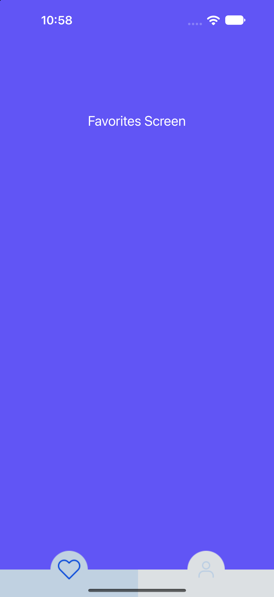

# Custom Tab Bar Controller

## Açıklama

Bu proje, UIKit kullanarak özelleştirilmiş bir Tab Bar arayüzü oluşturma çalışmasıdır. `UITabBarController` temel alınarak sistemin varsayılan tab bar'ı gizlenmiş ve yerine Storyboard üzerinde tasarlanan özel bir tab bar yerleştirilmiştir.

Uygulamada **Favorites** ve **Account** olmak üzere iki sekme bulunur. Kullanıcı sekmeler arasında geçiş yaptığında ilgili ekran görüntülenir ve seçili sekmenin ikon ile arka plan rengi güncellenir.

## Konular

### Custom Tab Bar

`UITabBarController`, birden fazla view controller arasında sekmeler aracılığıyla geçiş yapılmasını sağlayan bir container view controller'dır.

Bu projede `UITabBarController` sınıfından türetilen `MainTabbarController` sınıfı kullanılmıştır. Sistem tab bar'ı gizlenerek özel tasarımın görüntülenmesi sağlanmıştır.

```swift
tabBar.isHidden = true
```

Özel tab bar, Storyboard üzerinde oluşturulan bir `UIView` kullanılarak hazırlanmış ve `viewDidLoad()` içerisinde ana view'a eklenmiştir.

### Auto Layout ile Custom Tab Bar Yerleşimi

Özel tab bar'ın ekranın alt kısmında konumlandırılması için Auto Layout constraint'leri programatik olarak tanımlanmıştır.

- `bottomAnchor`: Tab bar'ın ekranın alt kısmına yerleşmesini sağlar.
- `heightAnchor`: Tab bar'ın yüksekliğini belirler.
- `leadingAnchor` ve `trailingAnchor`: Tab bar'ın yatayda ekran genişliğini kaplamasını sağlar.

### Tab Selection ve selectedIndex

Sekme butonlarına `IBAction` bağlantısı verilmiştir. Butonların `tag` değerleri kullanılarak hangi sekmenin seçildiği belirlenir.

`updateActiveTab()` metodu iki işlemi birlikte yönetir:

1. Seçili olmayan sekmelerin ikon ve arka plan renklerini pasif duruma getirir.
2. Seçilen sekmenin ikon ve arka plan rengini aktif duruma getirir.

Ardından `selectedIndex` güncellenerek ilgili view controller görüntülenir.

```swift
selectedIndex = tabIndex == 1 ? 1 : 0
```

`selectedIndex`, `UITabBarController` içerisinde görüntülenecek view controller'ı indeksine göre seçmek için kullanılır.

### Active ve Inactive State

Sekmelerin seçili ve seçili olmayan durumları için ayrı görsel varlıklar ve renkler kullanılmıştır.

| Durum | İkonlar | Arka Plan |
|---|---|---|
| Active | `favorite-active`, `account-active` | ActiveColor |
| Inactive | `favorite-inactive`, `account-inactive` | InactiveColor |

İkonlar ve renkler `Assets.xcassets` içerisinde tanımlanmıştır.

## Ekran Görüntüsü



## Teknolojiler

- Swift
- UIKit
- UITabBarController
- Auto Layout
- Storyboard
- Interface Builder
- Asset Catalog

## Kazanımlar

- `UITabBarController` kullanımı ve çalışma mantığı
- Varsayılan tab bar yerine özel bir arayüz oluşturma
- Programatik Auto Layout constraint'leri tanımlama
- `selectedIndex` ile view controller'lar arasında geçiş yapma
- Button `tag` değerleriyle sekme seçimini yönetme
- Aktif ve pasif durumlar için farklı ikon ve renkler kullanma