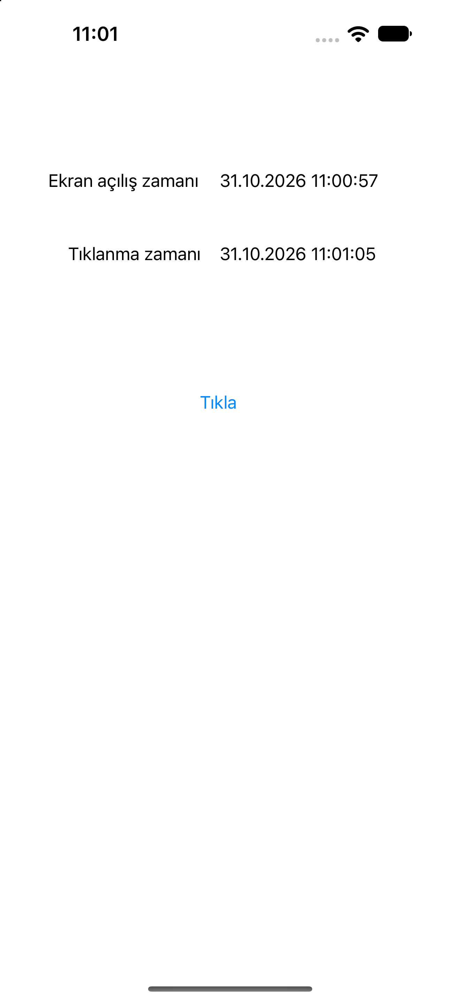

# Event Time Tracker

## Açıklama

Bu proje, UIKit kullanılarak ekranın açılış zamanını ve kullanıcı etkileşiminin gerçekleştiği zamanı takip eden basit bir uygulamadır.

Uygulama açıldığında ekranın açılış tarihi ve saati görüntülenir. Kullanıcı **Tıkla** butonuna bastığında ise butona basıldığı anın tarih ve saati ekranda gösterilir.

## Konular

### Date

Swift'te `Date`, belirli bir zaman noktasını temsil eder.

```swift
let time = Date()
```

`Date()` ile mevcut tarih ve saat bilgisi elde edilir. Projede hem ekranın açılış zamanını hem de butona basılma zamanını almak için kullanılmıştır.

### DateFormatter

`DateFormatter`, `Date` nesnesini belirlenen formatta metinsel bir ifadeye dönüştürmek için kullanılır.

Projede tarih ve saat bilgisi aşağıdaki formatta gösterilir:

```swift
let df = DateFormatter()
df.dateFormat = "dd.MM.yyyy HH:mm:ss"

return df.string(from: time)
```

Format bileşenleri:

| Format | Açıklama |
|---|---|
| `dd` | Gün |
| `MM` | Ay |
| `yyyy` | Yıl |
| `HH` | 24 saat formatında saat |
| `mm` | Dakika |
| `ss` | Saniye |

### View Controller Lifecycle

Ekranın açılış zamanını almak için `viewWillAppear(_:)` metodu kullanılmıştır.

```swift
override func viewWillAppear(_ animated: Bool) {
    let str = getTime()
    lblScreenTime.text = str
}
```

`viewWillAppear(_:)`, view ekranda görünmeden hemen önce çağrılır. Böylece ekran her görüntülendiğinde açılış zamanı güncellenir.

### IBOutlet ve IBAction

Storyboard üzerindeki UI bileşenleri ile `ViewController` arasında bağlantı kurulmuştur.

- `lblScreenTime`: Ekranın açılış zamanını gösteren UILabel.
- `lblTapTime`: Butona basılma zamanını gösteren UILabel.
- `btnTap_TUI`: Butonun tıklanma olayını karşılayan IBAction.

Butona basıldığında `getTime()` metodu çağrılır ve elde edilen tarih-saat bilgisi ilgili label'a aktarılır.

```swift
@IBAction func btnTap_TUI(_ sender: Any) {
    lblTapTime.text = getTime()
}
```

### getTime() Metodu

Tarih ve saat bilgisini tek bir noktadan elde edip biçimlendirmek için `getTime()` isimli yardımcı metot oluşturulmuştur.

Bu sayede aynı tarih formatlama kodu hem ekran açılışında hem de buton etkileşiminde tekrar yazılmadan kullanılabilir.

## Uygulama Akışı

1. Uygulama açılır.
2. `viewWillAppear(_:)` çağrılır.
3. `getTime()` metodu mevcut tarih ve saati alır.
4. Ekranın açılış zamanı `lblScreenTime` üzerinde gösterilir.
5. Kullanıcı **Tıkla** butonuna basar.
6. Butona basıldığı anın zamanı `lblTapTime` üzerinde gösterilir.

## Ekran Görüntüsü

<p align="center">
  
</p>

## Teknolojiler

- Swift
- UIKit
- Foundation
- Date
- DateFormatter
- IBOutlet & IBAction
- Xcode
- Interface Builder (Storyboard)

## Kazanımlar

- Swift'te `Date` kullanımı
- `DateFormatter` ile tarih ve saat biçimlendirme
- View controller lifecycle metotlarını kullanma
- Storyboard üzerinden IBOutlet ve IBAction bağlantıları kurma
- Kullanıcı etkileşimlerini yakalama
- Tekrarlanan işlemleri yardımcı metotlarla düzenleme