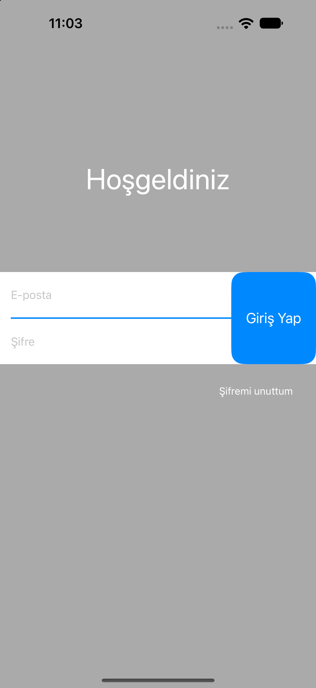

# LoginUI

## Açıklama

Bu proje, UIKit ve Storyboard kullanılarak basit bir login ekranı arayüzü oluşturmak amacıyla hazırlanmıştır.

Ekranda e-posta ve şifre giriş alanları, giriş yap butonu ve şifremi unuttum bağlantısı bulunmaktadır.

Arayüz tasarımında Auto Layout kullanılarak UI bileşenleri arasındaki boyut, hizalama ve konum ilişkileri tanımlanmıştır.

## Öğrenilen Konular

### UIKit

UIKit, iOS uygulamalarının kullanıcı arayüzünü oluşturmak ve kullanıcı etkileşimlerini yönetmek için kullanılan framework'tür.

Bu projede aşağıdaki UIKit bileşenleri kullanılmıştır:

- `UIView`: Giriş alanlarını ve butonu gruplamak için kullanılan container view.
- `UILabel`: Hoşgeldiniz başlığını göstermek için kullanılır.
- `UITextField`: E-posta ve şifre giriş alanları.
- `UIButton`: Giriş yap ve şifremi unuttum butonları.

### Storyboard ve Interface Builder

Storyboard, uygulamanın ekranlarını ve bu ekranlardaki UI bileşenlerini görsel olarak tasarlamayı sağlar.

Bu projede arayüzün tamamı `Main.storyboard` üzerinden oluşturulmuştur. UI bileşenlerinin hiyerarşisi ve görsel özellikleri Interface Builder kullanılarak düzenlenmiştir.

### Auto Layout

Auto Layout, arayüz elemanlarının boyut ve konumlarını diğer view'larla olan ilişkilerine göre belirlemeyi sağlar.

Bu projede kullanılan bazı constraint örnekleri:

- **Leading / Trailing:** Giriş alanlarının ve container view'ın yatay konumlarını belirlemek.
- **Center Y:** Giriş alanlarını içeren container view'ın dikey konumunu ayarlamak.
- **Height:** Container view'ın yüksekliğini ana view'ın yüksekliğine oranlamak.
- **Width:** Giriş butonunun genişliğini sabit tutmak.
- **Spacing:** E-posta ve şifre alanları arasındaki boşluğu belirlemek.

Constraint'ler sayesinde UI bileşenleri arasındaki ilişkiler tanımlanarak ekran yerleşimi oluşturulmuştur.

## Arayüz Yapısı

Login ekranı temel olarak üç bölümden oluşur:

1. **Başlık:** Ekranın üst bölümünde bulunan "Hoşgeldiniz" metni.
2. **Giriş alanları:** E-posta ve şifre için iki adet TextField ve giriş işlemi için bir buton.
3. **Şifremi unuttum:** Giriş alanlarının altında konumlandırılmış buton.

Giriş alanları ve giriş butonu aynı container view içerisinde gruplanmıştır. E-posta ve şifre alanları arasındaki mavi çizgi ise ayrı bir UIView kullanılarak oluşturulmuştur.

## Ekran Görüntüsü

  

## Teknolojiler

- Swift
- UIKit
- Storyboard
- Interface Builder
- Auto Layout

## Öğrenme Kazanımları

- UIKit bileşenlerini kullanarak arayüz oluşturma.
- Storyboard ve Interface Builder ile UI tasarlama.
- Auto Layout constraint ilişkilerini anlama.
- View hiyerarşisi ve container view kullanımını öğrenme.
- UI bileşenlerinin boyut ve konumlarını constraint'lerle düzenleme.