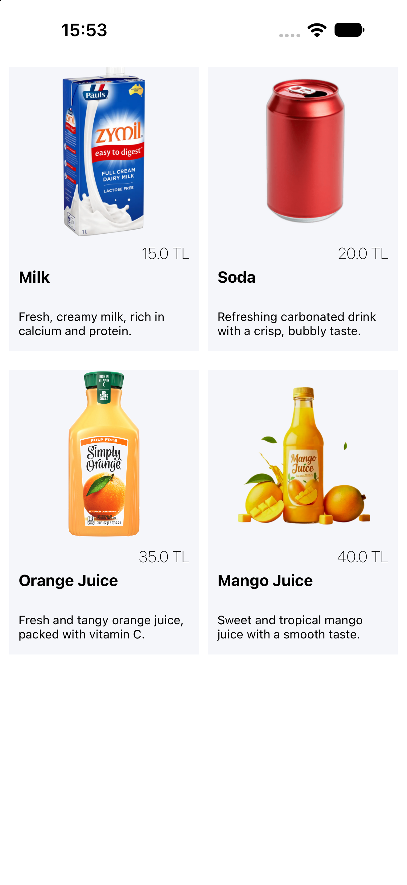

# ProductCollectionView

Swift ve UIKit kullanılarak geliştirilen, ürünlerin iki sütun halinde listelendiği bir iOS uygulaması.

Bu proje, `UICollectionView` kullanımını, XIB ile özel Collection View hücresi oluşturmayı ve `UICollectionViewFlowLayout` sınıfını özelleştirerek dinamik hücre boyutları belirlemeyi öğrenmek amacıyla hazırlanmıştır.

Uygulamada ürün görselleri, isimleri, kısa açıklamaları ve fiyatları gösterilir.

## Ekran Görüntüsü

<p align="center">
  
</p>

## Özellikler

- Ürünleri Collection View içerisinde listeleme
- Ürün görsellerini, başlıklarını ve kısa açıklamalarını görüntüleme
- Ürün fiyatlarını gösterme
- XIB ile özel Collection View hücresi tasarlama
- Ürünleri iki sütun halinde düzenleme
- Ekran genişliğine göre hücre boyutlarını dinamik hesaplama
- Collection View hücrelerini yeniden kullanma

---

## UICollectionView Nedir?

`UICollectionView`, iOS uygulamalarında verileri esnek ve özelleştirilebilir bir düzen içerisinde görüntülemek için kullanılan UIKit bileşenidir.

Grid, galeri, ürün kataloğu ve fotoğraf listeleri gibi arayüzlerde sıkça kullanılır.

`UITableView` verileri genellikle tek sütunlu satırlar halinde gösterirken `UICollectionView`, birden fazla sütun ve farklı yerleşim düzenleri oluşturulmasına olanak tanır.

Bu projede ürünler iki sütunlu bir grid yapısında görüntülenmektedir.

### UICollectionViewDataSource

`UICollectionViewDataSource`, Collection View içerisinde kaç öğe bulunacağını ve her öğenin nasıl oluşturulacağını belirler.

Projede `ViewController`, `UICollectionViewDataSource` protokolünü uygular.

**numberOfItemsInSection**

```swift
func collectionView(
    _ collectionView: UICollectionView,
    numberOfItemsInSection section: Int
) -> Int {
    return productList.count
}
```

Bu metot, ilgili section içerisinde kaç ürün gösterileceğini belirtir.

Ürün sayısı `productList.count` üzerinden hesaplandığı için listeye eklenen ürün sayısına göre hücre sayısı otomatik belirlenir.

**cellForItemAt**

`cellForItemAt`, Collection View içerisinde görüntülenecek her öğenin hücresini hazırlar.

Bu projede XIB üzerinden tasarlanan özel hücre yüklenir ve ilgili ürünün bilgileri hücre bileşenlerine aktarılır.

### UICollectionViewDelegate

`UICollectionViewDelegate`, hücre seçimi ve kullanıcı etkileşimleri gibi davranışları yönetmek için kullanılır.

Projede Collection View'in delegate bağlantısı ViewController'a yapılmış ancak özel bir delegate metodu uygulanmamıştır.

---

## Product Modeli

Ürün bilgilerini temsil etmek için `Product` adında bir model sınıfı oluşturulmuştur.

**Product.swift**

```swift
class Product {
    var image: String?
    var title: String?
    var shortDescription: String?
    var price: Float?
}
```

Model içerisinde dört özellik bulunur:

| Property | Açıklama |
|---|---|
| `image` | Ürün görselinin Asset Catalog içerisindeki adı |
| `title` | Ürün adı |
| `shortDescription` | Ürünün kısa açıklaması |
| `price` | Ürün fiyatı |

Ürünler `productList` dizisinde tutulur. Bu dizi Collection View'in veri kaynağı olarak kullanılır.

---

## Custom UICollectionViewCell

Collection View hücreleri, görüntülenecek içeriğe göre özelleştirilebilir.

Bu projede standart UICollectionViewCell yerine `ProductCollectionViewCell` adında özel bir hücre sınıfı oluşturulmuştur.

### ProductCollectionViewCell.swift

```swift
class ProductCollectionViewCell: UICollectionViewCell {

    @IBOutlet weak var productImageView: UIImageView!
    @IBOutlet weak var priceLabel: UILabel!
    @IBOutlet weak var titleLabel: UILabel!
    @IBOutlet weak var shortDescriptionLabel: UILabel!

}
```

Özel hücre dört arayüz bileşeni içerir:

- `productImageView`: Ürün görselini gösterir.
- `titleLabel`: Ürün adını gösterir.
- `shortDescriptionLabel`: Ürünün kısa açıklamasını gösterir.
- `priceLabel`: Ürün fiyatını gösterir.

Bu bileşenlerin tamamı `ProductCollectionViewCell.xib` dosyasında tasarlanmış ve IBOutlet bağlantılarıyla Swift sınıfına bağlanmıştır.

### XIB ile Hücre Tasarımı

XIB, arayüz bileşenlerini Storyboard'dan bağımsız olarak tasarlamak için kullanılır.

Bu projede `ProductCollectionViewCell.xib` dosyası içerisinde özel UICollectionViewCell tasarlanmıştır.

Hücrenin Custom Class değeri `ProductCollectionViewCell` olarak ayarlanmıştır. Böylece XIB üzerinden oluşturulan hücre, özel sınıfın özelliklerine ve davranışlarına sahip olur.

**Neden özel hücre kullanıyoruz?**

Ürün kartı gibi birden fazla görsel ve metin bileşeni içeren tasarımları standart hücreyle oluşturmak yerine özel bir hücre sınıfında toplamak daha düzenli bir yapı sağlar.

Ayrıca hücre tasarımı ViewController kodundan ayrılmış olur.

---

## XIB Kaydı ve Hücre Yeniden Kullanımı

Collection View'in XIB dosyasından oluşturulan özel hücreyi tanıyabilmesi için hücrenin önceden kaydedilmesi gerekir.

Bu işlem `viewDidLoad()` içerisinde gerçekleştirilir:

```swift
productsCollectionView.register(
    UINib(nibName: "ProductCollectionViewCell", bundle: nil),
    forCellWithReuseIdentifier: "ProductCollectionViewCell"
)
```

Burada:

- `UINib`: XIB dosyasını temsil eder.
- `nibName`: Yüklenecek XIB dosyasının adıdır.
- `bundle`: XIB dosyasının bulunduğu bundle'ı belirtir.
- `forCellWithReuseIdentifier`: Hücreyi çağırırken kullanılacak benzersiz tanımlayıcıdır.

**Neden register kullanılır?**

Collection View, özel hücreyi ihtiyaç duyduğunda oluşturabilmek için hücrenin nasıl yükleneceğini ve hangi identifier ile tanınacağını bilmelidir.

### dequeueReusableCell

Hücre kaydedildikten sonra `cellForItemAt` içerisinde `dequeueReusableCell` kullanılır:

```swift
let cell = collectionView.dequeueReusableCell(
    withReuseIdentifier: "ProductCollectionViewCell",
    for: indexPath
) as! ProductCollectionViewCell
```

`dequeueReusableCell`, daha önce oluşturulmuş ve artık ekranda görünmeyen hücreleri yeniden kullanabilir.

Örneğin kullanıcı ürün listesini aşağı kaydırdığında ekrandan çıkan bir hücre, yeni görünen ürünün bilgileriyle tekrar yapılandırılabilir.

**Neden hücreleri yeniden kullanıyoruz?**

Her ürün için yeni bir hücre oluşturmak yerine mevcut hücreleri yeniden kullanmak bellek ve performans açısından daha verimlidir.

Bu nedenle Collection View uygulamalarında `dequeueReusableCell` kullanımı önemlidir.

---

## UICollectionViewFlowLayout

`UICollectionViewFlowLayout`, Collection View öğelerinin satır veya sütun düzeninde yerleştirilmesini sağlayan hazır layout sınıfıdır.

Hücrelerin boyutlarını, satırlar arasındaki boşlukları ve aynı satırdaki öğeler arasındaki mesafeleri yönetebilir.

Bu projede standart `UICollectionViewFlowLayout` doğrudan kullanılmak yerine `ColumnFlowLayout` adında özel bir sınıf oluşturulmuştur.

### ColumnFlowLayout.swift

```swift
class ColumnFlowLayout: UICollectionViewFlowLayout {

    let columnCount: Int
    let heightRatio: CGFloat = (3.0 / 2.0)

    init(
        columnCount: Int,
        minColumnSpacing: CGFloat = 0,
        minRowSpacing: CGFloat = 0
    ) {
        self.columnCount = columnCount
        super.init()

        self.minimumInteritemSpacing = minColumnSpacing
        self.minimumLineSpacing = minRowSpacing
    }

    required init?(coder: NSCoder) {
        fatalError("init(coder:) has not been implemented")
    }

    override func prepare() {
        super.prepare()

        guard let collectionView = collectionView else { return }

        let spacings = collectionView.safeAreaInsets.left
            + collectionView.safeAreaInsets.right
            + minimumInteritemSpacing * CGFloat(columnCount - 1)

        let itemWidth = (
            (collectionView.bounds.size.width - spacings)
            / CGFloat(columnCount)
        ).rounded(.down)

        let itemHeight = itemWidth * heightRatio

        itemSize = CGSize(width: itemWidth, height: itemHeight)
    }
}
```

`ColumnFlowLayout`, `UICollectionViewFlowLayout` sınıfından türetilerek oluşturulmuştur. Böylece hazır flow layout davranışı korunurken hücre boyutları ihtiyaca göre özelleştirilir.

### columnCount

```swift
let columnCount: Int
```

Collection View içerisinde kaç sütun bulunacağını belirtir.

Bu projede iki sütun kullanılmaktadır.

### minimumInteritemSpacing

```swift
self.minimumInteritemSpacing = minColumnSpacing
```

Aynı satırda bulunan hücreler arasındaki minimum yatay boşluğu belirler.

### minimumLineSpacing

```swift
self.minimumLineSpacing = minRowSpacing
```

Satırlar arasındaki minimum dikey boşluğu belirler.

### prepare() Metodu

`prepare()`, Collection View layout işlemi başlamadan önce layout ayarlarının hazırlanmasını sağlayan metottur.

Bu metot override edilerek hücre boyutları Collection View'in genişliğine göre hesaplanmıştır.

**1. Collection View'e erişme**

```swift
guard let collectionView = collectionView else { return }
```

Layout'un bağlı olduğu Collection View'e erişilir. Collection View henüz mevcut değilse işlem sonlandırılır.

**2. Boşlukları hesaplama**

```swift
let spacings = collectionView.safeAreaInsets.left
    + collectionView.safeAreaInsets.right
    + minimumInteritemSpacing * CGFloat(columnCount - 1)
```

Hücrelerin genişliği hesaplanırken yatay kullanılabilir alan ve sütunlar arasındaki boşluk dikkate alınır.

İki sütun kullanıldığında sütunlar arasında tek bir yatay boşluk bulunur.

**3. Hücre genişliğini hesaplama**

```swift
let itemWidth = (
    (collectionView.bounds.size.width - spacings)
    / CGFloat(columnCount)
).rounded(.down)
```

Collection View'in genişliğinden boşluklar çıkarılır ve kalan alan sütun sayısına bölünür.

`rounded(.down)`, hesaplanan genişliği aşağı yuvarlayarak küsuratlı değerlerin oluşturabileceği küçük yerleşim sorunlarını azaltır.

**4. Hücre yüksekliğini hesaplama**

```swift
let itemHeight = itemWidth * heightRatio
```

Hücre yüksekliği, genişliğin `3 / 2` katı olarak belirlenir.

Böylece hücreler sabit bir ekran boyutuna bağlı kalmadan genişliklerine göre orantılı bir yüksekliğe sahip olur.

**5. itemSize değerini ayarlama**

```swift
itemSize = CGSize(width: itemWidth, height: itemHeight)
```

Hesaplanan genişlik ve yükseklik Collection View hücrelerinin boyutu olarak atanır.

### ColumnFlowLayout Kullanımı

Özel layout, ViewController içerisinde oluşturulur:

```swift
productsCollectionView.collectionViewLayout = ColumnFlowLayout(
    columnCount: 2,
    minColumnSpacing: 10,
    minRowSpacing: 20
)
```

Burada:

- `columnCount: 2`: İki sütunlu düzen oluşturur.
- `minColumnSpacing: 10`: Sütunlar arasında 10 point boşluk bırakır.
- `minRowSpacing: 20`: Satırlar arasında 20 point boşluk bırakır.

Bu sayede ürün kartları ekran genişliğine göre hesaplanan boyutlarla iki sütun halinde sıralanır.

---

## Ürünlerin Collection View'e Aktarılması

Örnek ürünler `viewDidLoad()` içerisinde oluşturularak `productList` dizisine eklenir.

Bu projede dört ürün bulunmaktadır:

| Ürün | Fiyat |
|---|---:|
| Milk | 15 TL |
| Soda | 20 TL |
| Orange Juice | 35 TL |
| Mango Juice | 40 TL |

Ürün görselleri `Assets.xcassets` içerisinde tutulmaktadır:

- `milk`
- `soda`
- `orange-juice`
- `mango-juice`

`cellForItemAt` içerisinde ilgili ürünün bilgileri hücreye aktarılır:

```swift
let p = productList[indexPath.row]

cell.titleLabel.text = p.title
cell.shortDescriptionLabel.text = p.shortDescription
cell.priceLabel.text = "\(p.price!) TL"
cell.productImageView.image = UIImage(named: p.image!)
```

Bu işlem sayesinde her Collection View hücresi, kendisine karşılık gelen ürünün bilgilerini görüntüler.

---

## Proje Yapısı

```text
ProductCollectionView/
├── ProductCollectionView.xcodeproj/
└── ProductCollectionView/
    ├── AppDelegate.swift
    ├── SceneDelegate.swift
    ├── ViewController.swift
    ├── Product.swift
    ├── ProductCollectionViewCell.swift
    ├── ProductCollectionViewCell.xib
    ├── ColumnFlowLayout.swift
    ├── Assets.xcassets/
    │   ├── milk.imageset/
    │   ├── soda.imageset/
    │   ├── orange-juice.imageset/
    │   └── mango-juice.imageset/
    └── Base.lproj/
        └── Main.storyboard
```

## Kullanılan Teknolojiler

- **Swift** – Uygulamanın programlama dili.
- **UIKit** – Kullanıcı arayüzü.
- **UICollectionView** – Ürünlerin grid düzeninde görüntülenmesi.
- **UICollectionViewDataSource** – Collection View verilerinin sağlanması.
- **UICollectionViewDelegate** – Koleksiyon görünümü etkileşimlerinin yönetilmesi.
- **UICollectionViewFlowLayout** – Hücrelerin yerleşim düzeninin belirlenmesi.
- **UICollectionViewCell** – Özel koleksiyon hücresi oluşturulması.
- **XIB / Interface Builder** – Özel hücre arayüzünün tasarlanması.
- **UINib** – XIB dosyasının Collection View'e kaydedilmesi.
- **Asset Catalog** – Ürün görsellerinin yönetilmesi.

## Öğrenilen Konular

- UICollectionView çalışma mantığı
- UICollectionViewDataSource ve UICollectionViewDelegate
- Custom UICollectionViewCell oluşturma
- XIB ile özel hücre tasarımı
- UINib ile hücre kaydı
- dequeueReusableCell ile hücre yeniden kullanımı
- UICollectionViewFlowLayout kullanımı
- UICollectionViewFlowLayout sınıfını özelleştirme
- prepare() metodunu override etme
- Dinamik hücre genişliği ve yüksekliği hesaplama
- İki sütunlu grid düzeni oluşturma

## Notlar

Bu proje, Collection View ve özel Flow Layout kullanımını göstermek amacıyla hazırlanmış örnek bir ürün listeleme uygulamasıdır.

Ürün verileri uygulama içerisinde statik olarak oluşturulmaktadır. Herhangi bir API bağlantısı veya kalıcı veri depolama işlemi bulunmamaktadır.

Ayrıca `Product` modelindeki özellikler Optional olarak tanımlanmıştır. Hücre yapılandırılırken fiyat ve görsel adında force unwrap (`!`) kullanıldığı için bu değerlerin her ürün için tanımlanmış olması gerekir. Daha güvenli bir uygulamada eksik değerler için varsayılan değerler veya güvenli Optional kontrolleri tercih edilebilir.